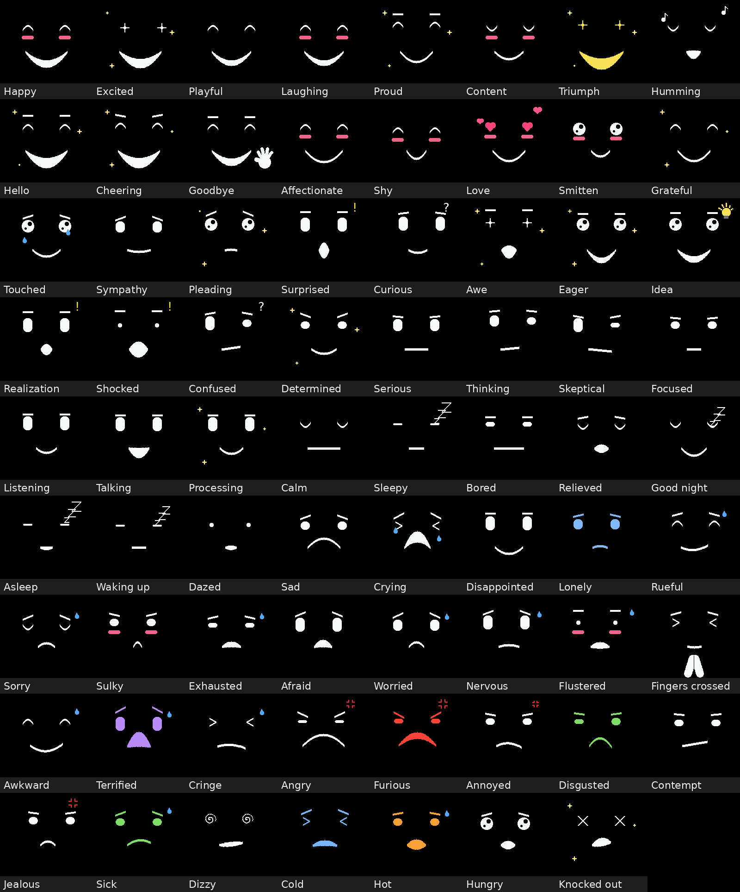
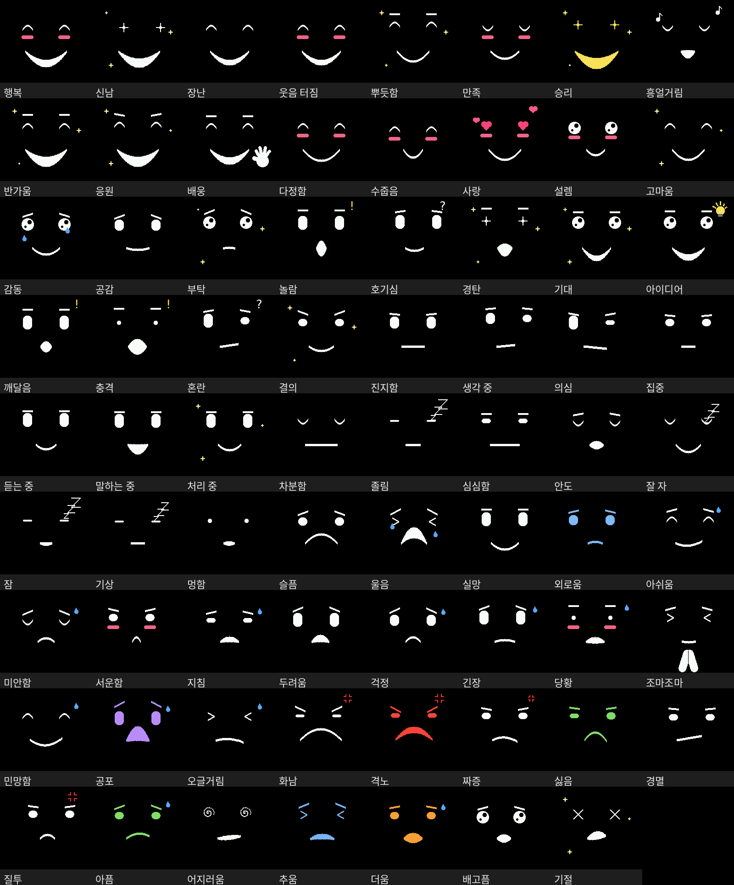

# AI Face

**A little face for your AI.** While you chat with Claude or ChatGPT (Codex), the AI picks a facial expression for each reply, and it shows up as an animated round face in your Mac's menu bar. Optionally, the same face can live on a small round LCD on your desk.

No hardware needed: the menu bar face works on its own. Everything runs locally on your Mac.



[한국어 설명은 아래에 있어요.](#한국어)

## What you get

- **78 animated moods in 11 groups** (happy, thinking, on it!, agree, facepalm, don't know, fingers crossed, ...). The AI chooses one per reply through a local [MCP](https://modelcontextprotocol.io) server, so the face follows the tone of the conversation.
- **Who chose it**: the ring around the face is orange for Claude, green for GPT and white when you pick a face yourself. Monochrome mode (menu bar only; the board stays in color) shows it with ring patterns instead.
- **Menu**: click the face for a short menu: timer (pomodoro) and keep awake, campfire and clock buttons next to the big face, and a click on the big face opens a picture grid of every mood (the ones you picked recently on top).
- **Keep awake** (optional): keep a MacBook awake with the lid closed for 1, 2 or 4 hours, from the menu. It turns itself off at the end, on low battery, when hot and when AI Face quits. Setup installs one sudoers rule that allows only `pmset -a disablesleep 0/1` (Settings → General → Keep awake). Claude Code can hold it while it works (hooks, Settings → AI apps), `awake COMMAND` holds it while a command runs, and AIs can ask for it ("keep the Mac awake for 20 minutes").
- **Screen savers** when the face has not changed for a while: sleepy → asleep, clock, photo, slideshow, pixel-art campfire.
- **History**: a daily log of which AI made which face, with stats and a timeline. Only the mood and the time are saved, never conversation text. AIs can read it too ("how were our faces today?").
- **Round LCD (optional)**: Seeed XIAO ESP32S3 + 1.28" GC9A01 240×240 round display, firmware included (updated from the app, no Arduino IDE window needed) and a 3D-printable case in `hardware/housing`.
- **Calendar (optional)**: AIs you allow can read the Mac's calendars (Exchange included): titles, times and places; notes and attendees only if you turn them on. Writing is allowed separately: AIs add events to the calendars you pick and change or delete only events they added, each change waiting for your OK (on by default), with undo. Settings → Calendar.
- **Mail (optional, read only)**: AIs you allow can list and read the Mail app's inboxes (accounts you leave on). Nothing is sent, moved, deleted or marked read; links show only their site and sign-in codes are hidden unless you turn that off. Settings → Mail.
- **Automatic updates**: when it starts and every 3 hours the app looks for a new version on GitHub (no account needed), and installs it only after the tests and the build pass; otherwise it keeps the running version. It waits while you or an AI are busy and never modifies the development folder. Settings → General → Updates.
- English and Korean, following your Mac's language.

## Requirements

- macOS 13 or later, and the Xcode Command Line Tools (the app is compiled on your Mac)
- Claude desktop and/or Codex (Claude Code works too). Faces only change in chats on the Mac: the Claude mobile and web apps cannot reach a local MCP server.

## Install

1. Install the Xcode Command Line Tools if you do not have them: `xcode-select --install`
2. Get the code: `git clone https://github.com/jason401/ai-face.git` (or download the ZIP).
3. Double-click **`Build AI Face.command`**. It stages a complete signed app and installs it in `/Applications`: a face appears in the menu bar and the settings window opens. The app is built on your own Mac, so it opens without a Gatekeeper warning. (If you downloaded the ZIP, macOS may block the `.command` file the first time: right-click it → Open, or allow it in System Settings → Privacy & Security.)
4. In **Settings → AI apps**, click **Connect** next to Claude desktop, Codex and/or Claude Code, then quit (⌘Q) and reopen those apps (start a new Claude Code session). Claude Code is registered for all folders (user scope) through its own `claude mcp add-json` command (if there is no `claude` on PATH, the copy inside the Claude app's Code tab is used).

The build installs `/Applications/AI Face.app`. Runtime Python code, firmware sources and setup scripts are included in the bundle; the development folder is not needed to run the installed app. Existing settings, photos, history and MCP paths stay in `~/Library/Application Support/AI Face/`.

Updates use a separate checkout at `~/Library/Application Support/AI Face/source`, following the public `stable` branch. Each Mac still needs Command Line Tools, Python and its existing **AI Face Local Signing** identity. This is a source-built personal installation, not a Developer ID/notarized binary distribution. Updates trust the configured GitHub repository; local signing does not authenticate the source publisher.

The face only changes while AI Face is running. When it is quit, the AI's face tools quietly do nothing and the chat carries on as usual (the board, if any, keeps its last face).

### The round LCD (optional)

- Board: Seeed XIAO ESP32S3; display: GC9A01 240×240 round SPI LCD (pins in `firmware/ESP32_Display/ESP32_Display.ino`).
- Once: Arduino IDE 2 with the ESP32 board package, or without the IDE: `brew install arduino-cli`, then install the `esp32:esp32` core (board URL `https://espressif.github.io/arduino-esp32/package_esp32_index.json`) and the libraries `Adafruit GFX Library` and `Adafruit GC9A01A`. After that, **Settings → Board → Update firmware** compiles and uploads the firmware.
- Plug the board in and the app connects to it by itself.

## Privacy

- Nothing leaves your Mac except what the AI apps already send: when an AI calls a tool, the result (for example the mood history) becomes part of that chat.
- **Connect** adds one entry (`ai-face`) to Claude desktop's and Codex's settings files, after making a backup copy; other settings are left alone.
- Automatic updates only download from the project's GitHub repository (`git fetch`); turn them off in Settings → General.
- Data (settings, photos, history) lives in `~/Library/Application Support/AI Face/`.

## Uninstall

1. Settings → AI apps → **Disconnect** for each app (or `python3 tools/install_mcp.py --remove`), and turn off **Open at login** in Settings → General.
   If you set up keep awake, remove its rule there too (Settings → General → Keep awake → Remove…).
2. Quit AI Face from its menu, then delete the project folder and, if you want, `~/Library/Application Support/AI Face/`.

## How it works

```
Claude / Codex ──MCP (stdio)──▶ ai_face_mcp.py ──HTTP (127.0.0.1)──▶ AI Face.app
                                                                      ├─ menu bar face
                                                                      └─ USB serial ─▶ ESP32 LCD (optional)
```

```
app/macos/*.swift       menu bar app (Swift): starts the server, menu bar face and menu, SwiftUI settings
core/ai_face_awake.py   keep-awake helper: Claude Code hooks and the `awake` command
core/ai_face_mcp.py     MCP stdio server ("ai-face"): one file that only forwards set_expression,
                        get_expression, start_timer, show_photo, ... to the running app
core/aiface/            Python core (standard library only)
  server.py             local server (127.0.0.1, random port + token), connects the board automatically
  integrations.py       registers the MCP server with Claude desktop / Codex
  board.py              ESP32 over USB serial (protocol FACE8)
  moods.py              the 78 mood animations, settings
  history.py            expression log and stats (moods only, never conversation text)
  library.py            photo library
  awake.py              keep awake with the lid closed (pmset disablesleep, with a deadline)
  calendar_access.py    calendar reading for the AIs (the app binary answers with EventKit: AIFace --calendar)
  mail_access.py        mail reading for the AIs, read only (the app binary asks Mail via Apple events: AIFace --mail)
  flasher.py            compile + upload the firmware with Arduino IDE's arduino-cli
firmware/ESP32_Display/ ESP32 firmware
hardware/housing/       3D-printable case
tools/                  app build script, CLI installer, firmware simulator, face preview and app icon (make_preview.py, make_icon.py)
tests/                  tests
```

User data lives in `~/Library/Application Support/AI Face/` (settings, photos, history). The registered MCP server is a copy of `core/ai_face_mcp.py` in the same folder (chat apps may not start programs in `~/Documents`); it reads the mood list (`moods.json`) and the app's address (`controller.json`) that the app writes there.

## Development

```
python3 -m unittest discover -s tests     # Python tests + firmware simulator
bash tools/firmware_sim/run.sh            # firmware simulator only (needs a C++ compiler)
```

- After changing code, run `Build AI Face.command` again (`zsh tools/build_app.sh --stage` only stages a candidate). Publish tested commits to `main`, then fast-forward `stable` separately. The app also refreshes the installed MCP server file when it starts, and moves data and registrations from older versions (`ESP32Face`, `esp32-face`) over to the new names.
- The app is built with `xcrun swiftc -swift-version 5` (no Xcode project). Do not use SwiftUI macros such as `@State`: the Command Line Tools do not ship the macro plugin.
- Languages: the app follows the Mac's preferred languages (English and Korean so far; anything else falls back to English). App texts are English in the code with translations in `app/macos/Resources/<lang>.lproj/Localizable.strings`; Python messages use `T(korean, english)` from `core/aiface/i18n.py`, and mood names are in `moods.EN`. The app passes its language to the server (`AIFACE_LANG`), which saves it for the MCP server.
- In the firmware, every struct used in a function signature must be declared above the `RingColorFn` typedef (where the Arduino builder inserts prototypes). The simulator follows the same rule.

## License

[MIT](LICENSE). Claude and ChatGPT are trademarks of their owners; this is an unofficial hobby project.

---

## 한국어

Claude나 GPT와 대화하면 AI가 대답마다 표정을 골라서 **맥 메뉴바의 동그란 얼굴**에 보여줘요. ESP32와 원형 LCD로 실물 얼굴도 만들 수 있어요(선택).

- 78가지 표정(11개 분류), 누가 골랐는지 테두리 색(Claude 주황 / GPT 초록 / 직접 흰색), 흑백 모드에서는 테두리 무늬로 구분
- 대기 화면: 졸림→잠, 시계, 사진, 슬라이드쇼, 픽셀 모닥불
- 타이머 링, 사진 보관함, 표정 기록과 하루 통계, 보드 펌웨어 업데이트(Arduino IDE 창 없이)
- 깨어 있기(선택): 1·2·4시간 동안 뚜껑을 닫아도 맥북이 잠들지 않게. 시간·배터리·발열·앱 종료 때 알아서 꺼져요
- 자동 업데이트: 앱을 켤 때와 3시간마다 GitHub에서 새 버전을 찾아, 테스트와 빌드가 통과하면 알아서 설치해요

보드 없이 메뉴바 얼굴만으로도 쓸 수 있고, 모든 게 맥 안에서만 돌아가요.



### 설치

1. `xcode-select --install`로 Xcode 명령줄 도구 설치(없을 때만)
2. `Build AI Face.command` 더블클릭 → `AI Face.app`이 만들어지고 실행돼요(메뉴바 얼굴, 설정 창).
3. 설정 → **AI 연결**에서 Claude 데스크톱 / Codex **연결**
4. Claude(와 Codex)를 ⌘Q로 껐다가 다시 실행

AI Face가 켜져 있을 때만 얼굴이 바뀌어요. 꺼져 있으면 AI의 표정 도구는 조용히 아무것도 하지 않고 대화는 평소처럼 이어져요.

앱은 맥 언어를 따라가요. 영어 맥에서 한국어로 쓰려면 시스템 설정 → 일반 → 언어 및 지역 → 앱에서 AI Face를 한국어로 고르세요.

자세한 사용법은 [docs/사용방법.md](docs/사용방법.md)에 있어요.

### 독립 설치 및 업데이트 (2026-10-28)

- 실행 앱: `/Applications/AI Face.app`. 개발 폴더를 옮겨도 실행됩니다.
- Python 코드·펌웨어 원본은 앱 내부, 데이터·로그·펌웨어 빌드 결과는 `~/Library/Application Support/AI Face/`에 보관합니다.
- 자동 업데이트는 그 폴더의 전용 `source`에서 `stable`을 받아 테스트·로컬 서명 빌드합니다. 개발 폴더는 수정하지 않습니다.
- 기존 로컬 서명 identity·Python·Command Line Tools가 필요합니다. 서명 실패 시 ad-hoc으로 전환하지 않습니다.
- 타이머·keep awake·캘린더 승인·펌웨어 업로드·진행 중 요청이 있으면 교체를 보류합니다. 새 서버의 revision 응답을 확인한 뒤 설치 완료로 처리하고, 실패하면 이전 앱을 복구합니다.
- 전원 중단 등으로 설치 기록이 남으면 자동 덮어쓰기를 막습니다. `tools/install_app.py --recover --support "$HOME/Library/Application Support/AI Face"`로 명시적으로 복구합니다.
- 공개 배포용 Developer ID·notarization·Sparkle은 후속입니다. 원격 소스는 GitHub 저장소를 신뢰하며, 로컬 서명은 원격 작성자 인증을 대신하지 않습니다.
