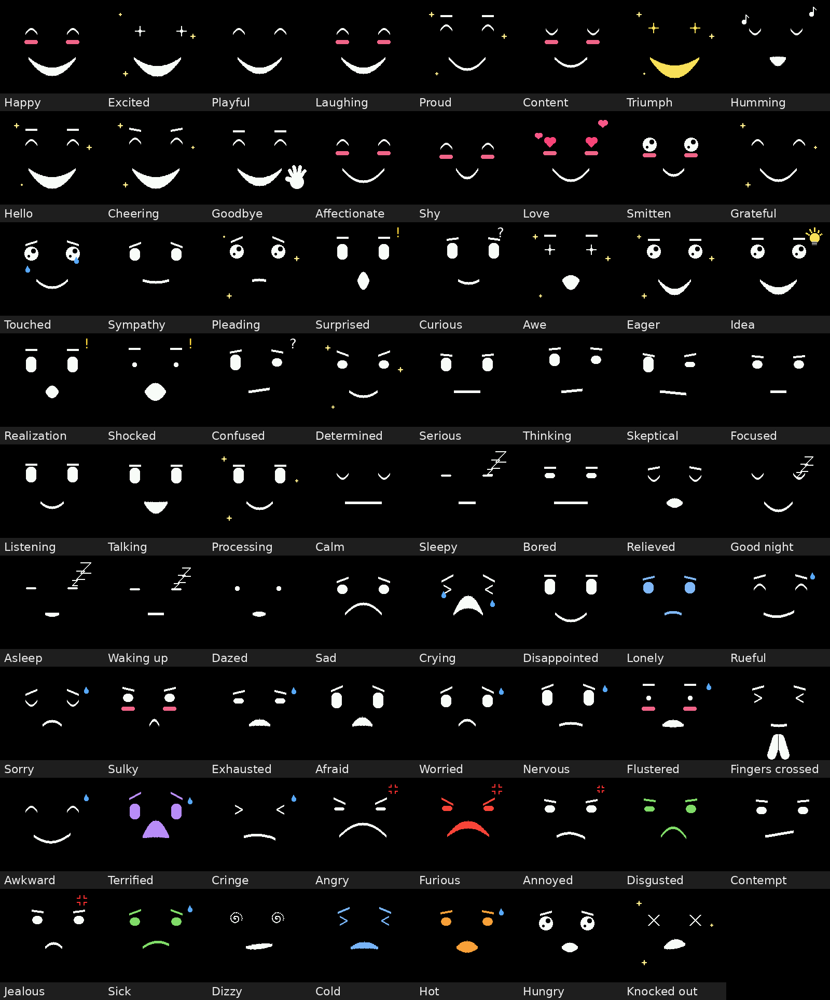
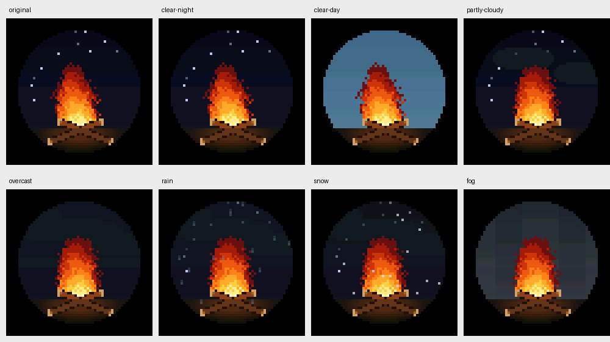

# AI Face

**A little face for your AI.** AI Face is a free, open-source macOS menu bar app. While you chat with Claude or Codex, the AI can choose an animated expression for each reply through a local MCP connection. An optional ESP32 round LCD can show the same face on your desk.

[Download from GitHub Releases](https://github.com/jason401/ai-face/releases) · [Installation guide](docs/INSTALL_RELEASE.md) · [User guide](docs/USER_GUIDE.md) · [MIT License](LICENSE)



## Features

- 78 animated expressions in 11 groups, from happy and thinking to curious, sleepy and facepalm.
- Claude-orange / GPT-green / AI Illuminati-gold / manual-white rings; monochrome menu bar mode uses patterns instead.
- Manual expression picker, timer, clock, photo/slideshow and campfire screen savers.
- Local expression history and statistics, with opt-in iCloud Drive sync across Macs; conversation text is not saved in that history.
- Optional, separately controlled Calendar access and read-only Mail access for connected AIs.
- Optional read-only shared folders: pick folders once, then any connected chat on this Mac can list, search and read them (PDF, Word, PowerPoint and text).
- Optional timed keep-awake support, with time, temperature, battery and app-exit safeguards.
- Optional Seeed XIAO ESP32S3 + GC9A01 240×240 round LCD; firmware source included.
- English and Korean interface, following your Mac's language.

## Download and install

1. Download **[AI-Face-2.2.0-source.zip](https://github.com/jason401/ai-face/releases/download/v2.2.0/AI-Face-2.2.0-source.zip)** from the official [Releases page](https://github.com/jason401/ai-face/releases). It is the only download needed; `SHA256SUMS.txt` is an optional integrity check.
2. Requires **macOS 13+**, **Xcode Command Line Tools** (Swift compiler, Git and the `/usr/bin/python3` runtime) and an internet connection. If missing, run `xcode-select --install` and finish Apple's installation. A paid Apple Developer membership is not required.
3. Extract the ZIP and double-click **`Install AI Face.command`**. It downloads the official `v2.2.0` tag, creates a local code-signing identity on this Mac (or reuses an existing one), builds AI Face and puts it in **Applications**. Approve macOS prompts yourself; the script never asks for a password. The first build takes a few minutes.
4. AI Face appears in the menu bar. In **Settings → AI**, connect Claude desktop, Codex, Claude Code and/or AI Illuminati. Quit and reopen Claude desktop or Codex after connecting. The conversation must expose the registered local MCP tools; this does not connect mobile/web chats or all chat modes automatically.

**This is a source installation package**, like AI Illuminati's, not a ready-to-run app. Building on your Mac with your Mac's own signing identity is what lets the app update itself later. No maintainer signing key or personal data is distributed. Full instructions and uninstall steps: [Installation guide](docs/INSTALL_RELEASE.md).

**Coming from the ready-made 2.1.0 download?** Run the installer once. It quits that app, moves it to the Trash and installs your own build; settings, history and photos stay. macOS may ask again for Calendar or Mail access, because the app's signature changed.

Optional integrity check: compare `shasum -a 256 <downloaded-zip>` with `SHA256SUMS.txt`. This does not certify that the software is safe.

### macOS security

The app uses a local signature, **not Apple Developer ID signing or notarization**; Apple has not verified it. Only run the installer from the official release page. If macOS blocks the `.command` file as from an unidentified developer, use **System Settings → Privacy & Security → Open Anyway** for this file after deciding you trust it. Do not disable Gatekeeper or SIP, and do not remove quarantine attributes in bulk. [Apple's guidance](https://support.apple.com/en-us/102445).

### Updates

The app checks the public `stable` branch at startup and every three hours (Settings → General). When a new version is found, it shows **Update now**; it installs only after you click it: it fetches, tests and builds on your Mac with your signing identity even during active work, then waits only to replace and restart the app. Prepared builds are reused while waiting; work completion wakes the updater promptly, with a ten-second fallback check and a countdown. Settings and history stay in `~/Library/Application Support/AI Face/`.

### Install directly from Git

```sh
git clone --branch stable --single-branch https://github.com/jason401/ai-face.git
cd ai-face
zsh tools/setup_signing.sh
zsh tools/build_app.sh
```

Signing setup creates a local code-signing certificate and private key on your Mac. Never share the private key or upload it.

### Optional LCD

Use Seeed XIAO ESP32S3 and a GC9A01 round SPI LCD (optionally with a CST816 touch chip for swiping between face, campfire and clock). Pins are documented in `firmware/ESP32_Display/ESP32_Display.ino`. Firmware compilation needs the ESP32 Arduino core, Adafruit GFX and Adafruit GC9A01A libraries. **Settings → Appearance → Board → Details… → Update firmware** compiles and uploads only when requested. No precompiled firmware is included in the desktop download.

## Privacy

- Settings, photos and expression history are stored locally in `~/Library/Application Support/AI Face/`, outside this source repository.
- History → iCloud Drive sync is off by default. Enabling it copies existing history to `iCloud Drive/AI Face/history/v1/devices/` and combines other Macs’ records using a local cache. Each Mac only changes its own directory. Turning sync off keeps local and cloud copies; deleting this Mac’s records propagates when sync is next enabled. Conversation text and hardware identifiers are never uploaded. Apple iCloud account settings control access to the cloud copies.
- Calendar, Mail and shared-folder access are optional and controlled per AI. Tool results sent to an AI become part of that provider's conversation; local app storage does not mean the AI provider processes everything locally.
- The app listens on `127.0.0.1`, not a public network interface. Mutations and Calendar/Mail/shared-folder reads require a runtime token. Some local read routes, including photo and expression-history reads, are not token-protected: other programs on the same Mac may read them. Do not expose this server through a public tunnel.
- GitHub updates/downloads require network access. Connecting an AI adds its MCP registration; it does not publish local account credentials or user data.

## Development

The Swift app uses system frameworks; Python runtime code uses the standard library. Builds need an **AI Face Local Signing** identity in the login keychain (`zsh tools/setup_signing.sh` creates one, or reuses an existing one). Never share its private key. The build stops if that identity is absent; there is no ad-hoc fallback.

```sh
PYTHONDONTWRITEBYTECODE=1 python3 -m unittest discover -s tests
bash tools/firmware_sim/run.sh
zsh tools/build_app.sh --stage       # stage only; installed app is untouched
zsh tools/package_release.sh v2.2.0 # source installation ZIP of a tag, with checksums
```

A normal source build installs only as a first installation (no AI Face in Applications, or one signed on another Mac); an app signed with this Mac's identity changes only through its own updates. The app's source updater uses a separate checkout; it never modifies this developer folder. See [release maintenance](docs/RELEASING.md) for packaging and verification.

## AI-assisted development

Developed with assistance from Claude and ChatGPT/Codex for implementation, debugging, tests and documentation. AI assistance is not an independent security audit, a guarantee of correctness, or an endorsement by those companies.

## License

Copyright © 2026 jason401. Project-owned material is available under the [MIT License](LICENSE), permitting use, modification and redistribution, including commercial use, with its required notices. External dependencies retain their own licenses; see [Third-party notices](THIRD_PARTY_NOTICES.md). Product names are trademarks of their owners; this is an unofficial project.

## Weather-aware campfire

The campfire can reflect local clear/partly cloudy/overcast/rain/snow/fog conditions, daylight and wind while keeping its original pixel-art fire. Appearance → Campfire weather lets you choose a city, use automatic current weather, or preview a selected date and city-local hour. Future dates are limited to the available forecast horizon (up to 15 days ahead); older dates use historical reanalysis. The Apply button opens the campfire. Return to Automatic for current conditions.

The Mac retrieves weather every 15 minutes and sends compact parameters to the board. Current conditions are model estimates, not direct local observations. A matching board firmware update is needed; older firmware remains usable with the original fire. Network/data failure retains the last valid selection for up to two hours, then restores the original scene. City selection is stored locally; the coordinates are sent to the weather service. No precise location permission, API key, microphone or camera is needed.

Weather data: [Open-Meteo](https://open-meteo.com/), [CC BY 4.0](https://creativecommons.org/licenses/by/4.0/). City search uses Open-Meteo's [GeoNames-based geocoding](https://open-meteo.com/en/docs/geocoding-api). The free endpoint is for non-commercial use; commercial distribution requires reviewing the provider's terms.



## History across Macs

In **Settings → History**, enable **iCloud Drive sync** on each Mac using the same iCloud Drive account. Storage remains local first; while offline the app keeps recording and displays the last verified records from other Macs. The status reports the last successful check or an iCloud wait. **Sync now** requests another background attempt.

The first enable asks whether to import existing records. If the same old history was manually copied to multiple Macs before this feature, choose **Import existing** on just one and **New records only** on the others. Skipped old records remain available when sync is off. Later migrations preserve record ownership automatically and give the new Mac a new identity; only its new records are uploaded under that identity.

History defaults to **All devices**; with multiple devices you can select **This Mac** or an individual peer. Dates are calculated in the viewing Mac's time zone. Current expressions, recent manual picks and AI expression tools use local records. Retention remains 400 days. **Delete this Mac’s history…** preserves other devices’ records; with sync off, cloud deletion waits until sync is enabled again.

The replication protocol uses date JSONL files and a versioned per-device manifest with increasing generations and SHA-256 checksums. Readers replace a peer cache only after verifying the complete generation; temporary missing files, older manifests and download failures never imply deletion. All cloud I/O runs in a subprocess with a 30-second deadline. Developer verification: stage a signed build, then run the named `history-icloud-probe` command (temporary probe data is removed).
