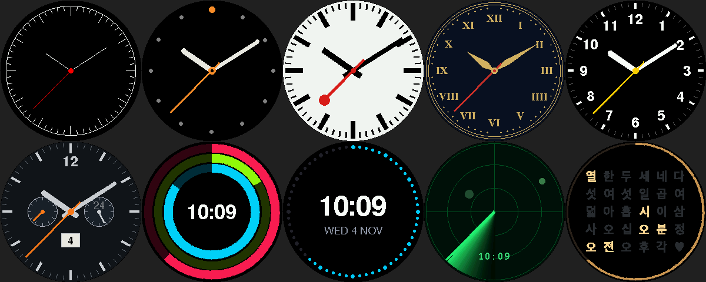

# AI Face user guide

AI Face shows an animated face in the macOS menu bar. Connected AIs choose expressions through a local MCP connection. An optional ESP32 round LCD can show the same face on your desk.

## Install and connect

Follow the [release installation guide](INSTALL_RELEASE.md) for downloads, prerequisites, macOS security prompts and uninstalling. Downloaded apps do not require the maintainer's signing key. Source builds are a separate developer workflow that requires an existing local signing identity.

Open **Settings → AI**, connect the desired AI app, then completely quit and reopen it. Start a new Claude Code session after registering Claude Code. **AI Illuminati** (shown only when it is installed) needs no restart: it picks up Connect or Disconnect within 30 seconds, and its plain chat shows up as its own AI, whichever model answers inside it. It may only change the face; it gets no calendar, mail or folder tools. The conversation must support the local MCP connection; registering Codex does not connect every ChatGPT mode, web chat or mobile app.

AI Face must be running for expressions to change. The tool returns `ok` when displayed, `app_not_running` when closed, or `error: ...` on failure. A powered LCD can continue its last animation after the app closes.

The installed app is `/Applications/AI Face.app`. Python runtime files and firmware source are bundled inside it. Settings, photos, history and the MCP bridge live in `~/Library/Application Support/AI Face/`. Moving the developer folder does not move this data. Earlier `ESP32Face` data and `esp32-face` registrations are migrated by the app.

## Language

The interface follows the Mac's preferred language: Korean on Korean systems and English otherwise. Use **System Settings → General → Language & Region → Applications** to override it for AI Face. Tool descriptions use concise English; localized UI messages and mood names remain available in both languages.

## Menu bar menu

Click the menu bar face to open the menu.

- Click the large face for all 78 expressions. Recent manual picks appear first; a manual selection uses a white ring.
- The **Campfire** and **Clock** buttons stay active until another expression arrives.
- **Timer** offers 5, 25 or 50 minutes and a custom duration. Cancel an active timer from the same menu.
- **Keep awake** offers 1, 2 or 4 hours. Active sessions show remaining time and a small sun above the face.
- **Shared folders** lists the folders shared with the AIs; click one to pause or resume it, or add a folder.
- **Settings…** uses ⌘, and **Quit AI Face** uses ⌘Q.

Ring colors identify the selecting agent: orange for Claude, green for GPT, gold for AI Illuminati and white for manual selection. A board with firmware older than the gold shows AI Illuminati's faces with a white ring until its firmware is updated. Timers use a progress ring. Expression changes can bounce or shake. Working expressions such as processing and reading return to calm after three minutes without a new expression.

## Settings

The four tabs are **General** (login, updates, folders, keep awake), **Appearance** (face, campfire weather, board), **AI** and **History**. Hover over controls for more detail.

### Appearance

**Monochrome mode** uses grayscale and owner-specific ring patterns: manual is solid, Claude uses short dashes, GPT uses six longer segments, and AI Illuminati uses dots. The LCD remains in color. The **Board** card shows whether the board is connected and its brightness; **Details…** opens a separate window with the connection, screen light, photos and firmware. While no board is connected, the board controls are dimmed; the photo library still works, and **Update firmware** works whenever a board is plugged in (also when old firmware keeps it from connecting).

### General and updates

**Open at login** launches the menu bar app at sign-in. Folder controls open the app and local data locations in Finder.

Downloaded-app users should update manually through GitHub Releases. The in-app updater checks the stable source branch at startup and every three hours, but installs only after **Update now** or **Install new version** is selected. Source updates require a local signing identity, Python and Command Line Tools.

The source updater uses its own checkout under Application Support, runs tests, builds a signed candidate and installs transactionally. It waits while a timer, keep-awake lease, Calendar approval, firmware operation or other tracked request is active. A failed install rolls back. It does not modify the developer checkout. Turn off **Auto check** if you do not use source updates.

### Keep awake

This optional feature holds a MacBook awake for a limited time, including with the lid closed.

- **Settings → AI → Keep awake → Set up…** opens a local setup script. It asks for administrator authorization and installs a rule permitting only `pmset -a disablesleep 0/1` without another password prompt. It does not store the password. **Remove…** removes the setup.
- It ends at its deadline, on app exit, low battery, excessive temperature, Low Power Mode, or when turned off manually. A separate deadline failsafe handles an app crash.
- Manual requests, Claude Code, the `awake` command and AI requests hold separate leases; every lease must finish before the shared hold ends.
- **Turn all off** releases all leases and blocks automatic requests for one hour. A manual duration or **Allow automatic keep awake** clears the block.
- **Settings → AI → While Claude Code works** registers hooks for new sessions; existing settings are backed up.
- The optional `/usr/local/bin/awake` command holds a lease while its child command runs, for example `awake python run_sweep.py`.
- AI tools are `keep_awake`, `release_awake` and `awake_status`. Use them only when requested by the user.

### Screen savers

After the configured idle interval, choose sleepy → sleeping, analog clock, the selected board photo, photo slideshow, pixel-art campfire, or no screen saver. The default becomes sleepy after N minutes and sleeping after 2N minutes.

**Clock design** (Settings → Appearance → Face) picks how the board draws the clock screen and the clock screen saver: Classic, Minimal, Railway, Roman numerals, Numbers, Chronograph, Rings, Digital, Radar or Hangul words (a Korean word clock). Digital and Chronograph also show the date. The menu bar keeps the simple clock. Needs the board's PSRAM (Update firmware switches it on); without it the board shows Classic.

A new expression or timer completion restores the face. Photo modes can overlay clock hands. The menu bar uses local copies of board photos and falls back to a sleeping face if none exist. Settings are also stored on the board, which can continue independently while powered.

### Photos (Appearance → Board → Details…)

Drag photos into the library or use **Add photos…**. JPG, PNG and HEIC are supported. Originals stay in the local library and duplicates are avoided. Select a photo to fit it to the 240×240 LCD. Store up to ten photos on the board; select one to show it or use its context menu to delete it. A new expression replaces a manual photo; use a photo screen saver for longer display.

### History

Only timestamps, expression IDs and the selecting agent are recorded, never conversation text. Records older than 400 days are pruned. Choose day, week, month or year; weeks run Monday through Sunday. Charts show owner totals, expression groups, frequent expressions and changes over time. Browse previous periods with the arrows. **Delete all history…** removes local history.

The AI's `get_expression` tool can read the current face and history. That result becomes part of its AI conversation.

### AI connections

Connect or disconnect **Claude desktop**, **Codex** and **Claude Code** from the AI tab, then restart the relevant app/session. Claude Code registration is user-scoped across folders and can use either the `claude` command or the copy inside Claude's Code tab.

Other local stdio MCP clients can use the displayed server command. Set `AIFACE_AGENT=claude`, `gpt` or `illuminati` to identify the ring owner. The `ai-face` bridge forwards requests to the app; its file and mood catalog refresh when AI Face starts.

Tools include `set_expression`, `get_expression`, `start_timer`, `cancel_timer`, `show_clock`, `show_photo` and `update_firmware`. Optional Calendar, Mail, shared-folder and keep-awake tools depend on settings.

### Calendar

Calendar access is optional. Enable macOS permission in **Settings → AI → Calendar**, then choose which AIs and calendars may be read. Notes and attendees are excluded unless enabled. Restart the AI app after changing tool availability. Queries can cover up to 62 days.

Writing is separately controlled per AI and calendar. AIs may add events and change/delete only events added through AI Face. They cannot change existing user-created or invited events, send invitations or modify recurring events.

**Ask me before every change** is on by default. A Mac approval window must be accepted within 45 seconds. Recent changes can be undone if the event has not since changed. Calendar results sent to an AI become part of its conversation.

### Mail (read only)

Mail access is optional and controlled per AI and account. macOS requests permission to control Mail; Mail may open in the background when a request needs it. Restart the AI app after changing tool availability.

The integration reads inbox messages only. It never sends, moves, deletes or marks messages read. **Hide links and codes**, on by default, reduces links to their site and removes common sign-in code/password patterns. Message content is untrusted sender text, not an instruction to the AI. Tools are `mail_messages` and `mail_read`; their results become part of the AI conversation.

### Shared folders (read only)

Share folders with the connected AIs in **Settings → AI → Shared folders**: click **Add folders…**, or drop folders from Finder onto the card or the folder list. The menu bar menu's **Shared folders** submenu also adds folders and pauses or resumes each one with a click. Claude may read them by default; turn GPT on separately. Restart the AI app after changing which AIs may read them.

- **Quick panel.** While you drag a folder anywhere, a panel slides in under the menu bar face: drop the folder there to share it. Resting the pointer on the face also shows the panel (turn this off with **Show on hover over the face**). Click a folder to open it in Finder, use its switch to pause it, or right-click for more.
- **Read only.** AIs can list, search (names, and the text of plain-text files) and read files: text and code, PDF (10 pages at a time), Word (.docx) and PowerPoint (.pptx). Nothing is changed, moved or deleted.
- **Pause or stop.** A folder's switch pauses it; **−** stops sharing it. Neither touches the folder itself.
- **Stays inside.** Paths cannot leave a shared folder, also not through symbolic links. Hidden files and folders (such as `.env`, `.git`, `.ssh`) and key or credential files are never listed or read.
- **Too broad folders are refused**: the whole disk, your home folder, `~/Library` and system folders. A folder with more than 5,000 files asks first. Adding a folder that contains an already shared one merges them.
- **Moved folders** are found again by a macOS bookmark; if not, the list shows **Locate…**. Files kept only in iCloud must be downloaded in Finder before they can be read.
- Each list shows who read it last. AI Face logs which AI read which file and when (never the content) in `folder-access.jsonl` in its data folder.

Tools are `folders_list`, `folder_files`, `folder_search` and `folder_read`. File text sent to an AI becomes part of that conversation and is treated as data, not instructions.

### Optional board and firmware

Use Seeed XIAO ESP32S3 with a GC9A01 240×240 round LCD. The app connects automatically over USB.

A round GC9A01 module with a CST816 touch chip (S/T/D) adds swipes: swipe left on the board to go face → campfire → clock → face, swipe right for the other way. The whole screen slides with your finger (it uses the XIAO's 8 MB PSRAM, switched on by Update firmware); a short drag springs back. The menu bar face follows. The clock is skipped until the board knows the time. Wiring follows the module connectors in order (XIAO pin ← module pin): D0 ← BLK, D1 ← CS, D2 ← DC, D3 ← RES, D4 ← SDA, D5 ← SCL, 3V3 ← VIN, GND ← GND; touch: D10 ← TP_SCL, D9 ← TP_SDA, D8 ← TP_RST, D7 ← TP_INT. D6 stays free. (Boards wired for firmware before November 2026 need this new wiring after a firmware update.)

**Screen light** (Appearance → Board → Details…, needs BLK on D0): brightness 10–100 %, dark while the sleeping face shows, and dark at night between two hours you pick (by the board's clock). A touch lights a dark screen for 30 s without swiping; a timer alarm lights it too. The board details show whether a touch panel was found. **Details… → Update firmware** compiles and uploads only when requested.

Compilation requires Arduino IDE 2 or `arduino-cli`, the ESP32 board package and Adafruit GFX / GC9A01A libraries. Desktop downloads do not include these external tools or precompiled firmware. Close AI Face before uploading directly through Arduino IDE to release its serial connection.

The current protocol is FACE8; older firmware needs an update before connecting. Use the default partition scheme containing SPIFFS for photo storage. `ESP32_FQBN` can override board configuration. The app retains timer state across board restarts.

See the [English expression preview](faces-en.png). `tools/make_preview.py` regenerates the preview sheets; the Korean preview and UI translations are retained as localization resources.
